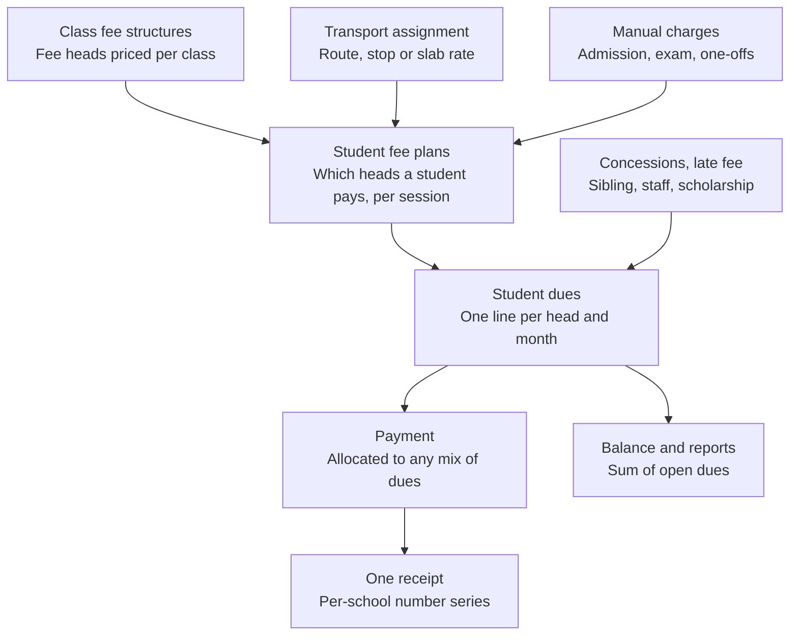

# Sunrise School: Multi-Tenancy & Unified Fee Redesign Plan

Nov 6, 2026 · Javed Ansari · Live version: https://claude.ai/artifact/G1QH43FrVzMPFVnxJLXBNa

## Overview

We will turn the Sunrise School backend into a multi-school (multi-tenant) service and replace the separate fee and transport billing code with one unified fee module. All work happens in the existing repository on a `multi-tenant` branch. The app is not in production, so old fee and transport data does not need to be migrated.

**Goals**

- Every school's data is isolated, so a user of one school can never read or change another school's records.
- All money a student owes (tuition, transport, admission, exam, one-off charges) is billed, paid, receipted and reported in one place.
- Transport keeps only operational data (vehicles, routes, stops, who rides what) and hands its charges to the fee module.

**Guiding decisions**

- Stay in this repository. The other modules (students, teachers, attendance, leave, inventory, gallery, auth) are reused and made tenant-aware.
- Build the tenant foundation first, then build the new fee module tenant-aware from its first line.
- No code changes until the open decisions in this doc are settled.

**How to use this doc:** check Progress for where work stands, then work through the Implementation phases checklist in order. Tick items as they land and update the Progress table at the end of each work session.

## Progress

Phase 1 is in progress on the `multi-tenant` branch. The app now lives in the `school` schema of the shared `warsi_db` database, built from a clean 3.0 baseline, and its 29 isolation tests pass (Nov 6, 2026). Next step: set the `warsi_user` password in `.env`, deploy the baseline to local `warsi_db`, then build the platform admin role and school management endpoints.

Status values: Not started, In progress, Done, Blocked.

| Phase | Status | Notes |
| --- | --- | --- |
| 0. Preparation | Done | Branch `multi-tenant` created. Tenant test suite runs against local Postgres in a rolled-back transaction |
| 1. Tenant foundation | In progress | Baseline 3.0 with school_id, models, automatic session scoping, school-aware login and tokens done. Local deployment, platform admin and school management pending |
| 2. Unified fee module core | Not started | Payment gateway deferred (decision 11) |
| 3. Transport operations module | Not started | |
| 4. Switch dependents and remove old code | Not started | |
| 5. Scope the remaining modules | Not started | ORM queries are already scoped by Phase 1. Remaining: 75 raw SQL queries and 5 views |
| 6. Frontend | Not started | |
| 7. Hardening | Not started | Includes row-level security (decision 12) |

## Current state

Fees and transport are two parallel billing systems with the same shape: a charge, month-wise tracking, payments, allocations and reversals, each built twice. The service is single-school: no table has a school or tenant column.

| Concept | Fee module (today) | Transport module (today) |
| --- | --- | --- |
| Price list | `fee_structures`: one row per class and session, fixed columns (tuition, admission, development, activity, transport, library, lab, exam, other) | `transport_types`, `transport_type_pricing` (per session), `transport_distance_slabs` |
| What a student owes | `fee_records` (annual, with sibling waiver fields) | `student_transport_enrollment` (monthly fee, distance, pickup and drop text) |
| Month-wise dues | `monthly_fee_tracking` | `transport_monthly_tracking` |
| Payments | `fee_payments` (receipt number `FEE-000123`, Cloudinary receipt, reversals) | `transport_payments` (same fields, separate numbering) |
| Payment to month split | `monthly_payment_allocations` | `transport_payment_allocations` |
| Audit | `fee_payment_audit_log` | none |

**Code size and coupling**

- `endpoints/fees.py` is about 4,000 lines with 38 routes. `endpoints/transport.py` adds 887 lines and 13 routes. Business logic lives mostly in the endpoint files, not in CRUD or services.
- A `pay-combined` endpoint already exists to take tuition and transport in one transaction with one receipt. That workaround is the clearest signal that one fee module is wanted.
- Five modules outside these two read fee or transport data: dashboard, student siblings, reports, student CRUD and metadata.

**Pain points to fix in the redesign**

- Duplicate logic for dues, payments, allocations and reversals, so every fix is made twice.
- Fixed fee columns on `fee_structures`: adding a new fee head (for example, a computer fee) needs a schema change.
- `fee_structures.transport_fee` overlaps with the transport module's own pricing.
- Two receipt series and two payment histories per student, so the parent and the office see split balances.
- Hardcoded session years (`SessionYearEnum` stops at 2026-27) and a Sunrise-specific WhatsApp template and config.
- Globally unique `admission_number`, `employee_id` and `email`, which will clash once two schools share the database.

## Multi-tenancy design

Recommended model: one shared PostgreSQL database, with a `school_id` column on every school-owned table, enforced in a tenant-scoped base CRUD layer and later backed by row-level security. It is the simplest model to run and keeps a single migration path. The app's tables live in one schema (`DB_SCHEMA`, default `school`) of the shared `warsi_db` database, locally and on DigitalOcean, next to the `mart` schema.

**New tables**

- `schools`: id, code (short slug used in the subdomain), name, address, contact details, logo URL, timezone, currency, academic year start month, status (active or suspended), created_at.
- `school_settings`: per-school key and value settings such as the receipt prefix, WhatsApp sender and template IDs, late fee rules, and Cloudinary folder.

**How each request finds its school**

1. The frontend is served per school, at `<code>.<BASE_DOMAIN>`. The API reads the school from the `X-School-Code` header, else the subdomain of the `Origin` header (sent by browsers on every API call), else the `Host` header. Local development falls back to `DEFAULT_SCHOOL_CODE`.
2. Login checks the user against that school and puts `school_id` in the JWT (`sid` claim). Tokens without it are rejected, so users log in again once.
3. `get_current_user` reads `school_id` from the token, rejects the token on another school's subdomain, and binds the request's DB session to that school. Routes used before login (login, register, public pages, gallery) use `get_school_db` instead.
4. SQLAlchemy session events (`app/core/tenant.py`) add `school_id = <current>` to every ORM select, update and delete on a tenant model, including joins and relationship loads, and stamp `school_id` on every insert. A query or write on a tenant model without a school fails instead of leaking. This replaces the planned base CRUD filter, because 268 queries bypass `CRUDBase`. Raw SQL (`text()`) is not covered and is scoped by hand in Phase 5.
5. Phase 7 safety net: PostgreSQL row-level security policies on the same column, using a session variable set per request.

**Which tables get `school_id`**

| Group | Tables | Treatment |
| --- | --- | --- |
| School-owned data | students, teachers, users, attendance, leave, expenses, vendors, inventory, gallery, alerts, student siblings, student session history, all new fee and transport tables | Add `school_id NOT NULL`, index it, include it in unique keys |
| School-configurable lists | classes, session years, departments, positions, expense categories, gallery categories, inventory categories and types, leave types | Add `school_id`, name unique per school, auto-increment ids. Seed defaults for each new school |
| Fixed system lists | user types, genders, payment methods, payment statuses, attendance statuses, attendance periods, leave statuses, expense statuses, reversal reasons, qualifications, employment statuses, progression actions, alert types and statuses | Stay global, no `school_id` |

**Unique keys that change to per-school**

- `students.admission_number` becomes unique on (`school_id`, `admission_number`).
- `teachers.employee_id` becomes unique on (`school_id`, `employee_id`).
- Receipt numbers become unique per school.
- `users.email`: see Open decisions.

**Roles**

- A new platform admin role (user type `PLATFORM_ADMIN`) manages schools and is the only role allowed to act across schools. The existing `SUPER_ADMIN` type stays a school-level role, so the name is not reused.
- Existing roles (admin, teacher, student, parent) stay, scoped to their school.

**Per-school configuration to move out of code**

- School name and branding used in receipts, WhatsApp messages and the frontend.
- WhatsApp template IDs in `core/config.py`.
- Cloudinary folders for receipts and gallery images.
- Session years, generated per school instead of the hardcoded `SessionYearEnum`.

## Unified fee design

Proposal: one fee ledger in which every charge, whether tuition, transport, admission, exam or a one-off, is a row of the same kind tagged with a fee head. Payments, allocations, receipts, reversals and reports are written once and work for every fee head.

Tuition, transport and one-off charges all become plan lines, then dues. Payments settle dues, never a module, so a parent sees one balance and gets one receipt.

**Core ideas**

- **Fee heads instead of fixed columns.** Each school defines its own heads (Tuition, Transport, Admission, Exam, Computer, Late fee and so on). A new head is a row, not a migration.
- **Price lists by rule.** Class-based heads are priced per class and session. Transport is priced per route, stop or distance slab and session. Both feed the same ledger.
- **One due row per student, head and period.** This replaces `monthly_fee_tracking` and `transport_monthly_tracking`.
- **One payment can pay any mix of dues.** It produces one receipt from one per-school receipt series. This replaces `pay-combined`.
- **Concessions are explicit.** Sibling waivers, staff-child discounts and scholarships become concession rows with a reason and an approver, not fields copied onto each record.

**Proposed tables** (all carry `school_id`)

| Table | Purpose | Key columns |
| --- | --- | --- |
| `fee_heads` | The school's list of fee types | code, name, category (academic, transport, one-time, penalty), default frequency, is_active |
| `fee_structures` | Header for a price list | session_year_id, name, status (draft, published) |
| `fee_structure_items` | One price line in a list | fee_structure_id, fee_head_id, class_id (null means all classes), amount, frequency (monthly, quarterly, half-yearly, annual, one-time), billing months, due day |
| `student_fee_plans` | Which heads apply to a student in a session, and at what amount | student_id, session_year_id, fee_head_id, amount, start month, end month, source (class, transport, manual), source_ref_id |
| `concession_rules` and `student_concessions` | Discounts and waivers | type (sibling, staff, scholarship, custom), percent or fixed amount, fee heads covered, reason, approved_by |
| `student_dues` | One billable line per period | student_id, session_year_id, fee_head_id, period (year and month), gross amount, concession amount, late fee, net amount, paid amount, due date, status |
| `payments` | Money received | student_id, receipt_number, amount, method, date, transaction ID, receipt URL, created_by, reversal fields |
| `payment_allocations` | Which dues a payment settled | payment_id, student_due_id, amount, is_reversal |
| `receipt_sequences` | Per-school, per-session numbering | school_id, session_year_id, prefix, next number |
| `fee_audit_log` | Who changed what | entity, entity_id, action, old and new values, performed_by |

**Rules the module enforces**

- Dues are generated, never typed: from `student_fee_plans` for the session, by a "generate dues" action per school or class, and again when a student joins, changes class or starts or stops transport.
- A paid or part-paid due is never edited. A change creates an adjustment line or a reversal, so the ledger stays auditable.
- Allocation order for a payment is oldest due date first, unless the cashier picks specific dues.
- Student balance is always the sum of open `student_dues`, which gives one balance for parents, the office and the dashboard.

## Transport management after the split

Transport becomes an operations module. It decides who rides, on what, from where and at what rate. It never stores dues or payments. When a student is assigned or removed, it creates or ends a Transport line in `student_fee_plans`, and the fee module does the billing.

**Proposed tables** (all carry `school_id`)

| Table | Purpose | Key columns |
| --- | --- | --- |
| `transport_types` | Kinds of vehicle the school uses | name (E-Rickshaw, Van, Bus), capacity, is_active |
| `vehicles` | Each physical vehicle | transport_type_id, registration number, capacity, driver name and phone, is_active |
| `routes` | A named route | name, vehicle_id, is_active |
| `route_stops` | Ordered stops on a route | route_id, stop name, sequence, distance_km, pickup time, drop time |
| `transport_rates` | Price per session | session_year_id, pricing basis (flat per type, distance slab or per stop), transport_type_id, distance from and to km, route_stop_id, monthly amount |
| `student_transport_assignments` | Who rides what | student_id, session_year_id, route_id, stop_id, transport_type_id, start date, end date, monthly amount resolved from `transport_rates`, remarks |

**What happens on each event**

| Event | Transport module | Fee module |
| --- | --- | --- |
| Student assigned | Creates the assignment and resolves the monthly rate | Adds a Transport plan line from the start month, then generates its dues |
| Rate or stop changed | Ends the old assignment, starts a new one | Ends the old plan line, adds a new one. Paid months stay as they are |
| Student discontinued | Sets the end date | Ends the plan line and cancels future unpaid Transport dues |
| Service paused for some months | Records the paused months | Skips or waives those dues |

This replaces `student_transport_enrollment`, `transport_monthly_tracking`, `transport_payments`, `transport_payment_allocations`, `transport_type_pricing` and `transport_distance_slabs`. Vehicles, routes and stops are new. They are optional for a school that only needs flat or distance pricing.

## Open decisions

All 12 decisions were settled on Nov 6, 2026. Eleven follow the recommendation. Decision 2 was changed to subdomains only.

| # | Decision | Options | Agreed approach | Status |
| --- | --- | --- | --- | --- |
| 1 | Existing data | Start with an empty database, or keep current data as school 1 | Keep the current data as school 1 (Sunrise) for the non-fee modules. Drop the old fee and transport tables | Agreed |
| 2 | How a school is identified at login | Subdomain, school code on the login page, or both | A subdomain per school, for example `sunrise.<domain>`. No school code field. Local development and tests use a configured default school | Changed |
| 3 | User email uniqueness | Unique per school, or one global login with access to several schools | Unique per school, on (`school_id`, `email`). Revisit only if one person must work in two schools | Agreed |
| 4 | Classes and session years | Global lists, or per school | Per school, seeded with defaults when a school is created | Agreed |
| 5 | Billing frequency | Monthly only, or per fee head (monthly, quarterly, half-yearly, annual, one-time) | Per fee structure item, default monthly | Agreed |
| 6 | Transport start or stop mid-month | Charge the full month, pro-rata by days, or a cut-off day | Full month, with a per-school cut-off day setting | Agreed |
| 7 | Late fee | None, fixed amount, or percentage. Automatic or manual | Per-school setting. Added automatically as a separate Late fee due after the grace days | Agreed |
| 8 | Sibling concession | Which fee heads it covers and which child gets it | Rule-based, tuition only by default, applied to the second and later child. Heads and percent are configurable | Agreed |
| 9 | Receipt number format | Global sequence, or per school and session | Per school and session, for example `SUN/2026-27/000123` | Agreed |
| 10 | Advance and excess payments | Reject, or hold as student credit | Hold as credit and apply it to the next dues automatically | Agreed |
| 11 | Online payment gateway | In scope now, or later | Later. Keep gateway fields (order ID, status) on `payments` now | Agreed |
| 12 | Row-level security | Now, or after the CRUD layer is scoped | After, as Phase 7 | Agreed |

## Implementation phases

There are eight phases, run in order. Each phase ends with the app running and its tests passing, so work can pause between phases.

### Phase 0: Preparation

- [x] Clean the working tree (uncommitted changes reverted on Nov 6, 2026)
- [x] Create the `multi-tenant` branch
- [x] Settle all Open decisions
- [x] Set up a test base: `sunrise-backend-fastapi/tests/tenant` runs against local Postgres inside a rolled-back transaction. The old `tests/backend` suite imports a missing module and does not run

### Phase 1: Tenant foundation

- [x] `schools` and `school_settings` tables, Sunrise seeded as school 1
- [x] `school_id NOT NULL` (no default) on 27 tables, with foreign key and index
- [x] Migration: per-school unique keys (list names, admission number, employee ID, student, teacher and user email)
- [x] Migration: auto-increment ids on the 9 list tables that had none
- [x] `TenantMixin` on the 27 models, plus `School` and `SchoolSetting` models
- [x] `school_id` in the JWT at login, `get_current_school` and `get_school_db` dependencies, token refused on another school's subdomain
- [x] Automatic session scoping and write stamping in `app/core/tenant.py` (replaces the base CRUD filter)
- [x] Configuration metadata cache keyed per school, HTTP caching set to private
- [x] CORS accepts every `*.BASE_DOMAIN` school subdomain in production
- [x] Clean database baseline 3.0: legacy migrations V001 to V036 folded into the table scripts and archived. Scripts are schema-agnostic and never change the database-wide `search_path`. Verified identical to the migrated legacy schema
- [x] App and scripts use a configurable schema (`DB_SCHEMA=school`) in the shared `warsi_db`. 67 hardcoded `sunrise.` table prefixes removed from raw SQL
- [x] `redeploy_database.py` drops and recreates only the `DB_SCHEMA` schema; `mart` and `public` are untouched
- [x] SSL support for DigitalOcean (`?sslmode=require` in `DATABASE_URL`)
- [x] Removed unused database objects: 5 views, `calculate_age`, `get_academic_year`
- [x] `migrate_database.py`: applies each `Database/Versioning/` migration once, recorded in `schema_migrations` with a checksum; stops on edited or failing migrations
- [ ] Set the `warsi_user` password in `sunrise-backend-fastapi/.env`, then run `python redeploy_database.py` to deploy to local `warsi_db`
- [ ] Deploy to DigitalOcean `warsi_db` (schema `school`), and set `DATABASE_URL`, `DB_SCHEMA`, `BASE_DOMAIN` and `DEFAULT_SCHOOL_CODE` on the backend host
- [x] Delete the unauthenticated `POST /api/v1/database/deploy`. `redeploy_database.py` now deploys local databases directly from the complete `deploy_database.sql` list
- [ ] Platform admin role and school management endpoints (create, edit, suspend), seeding default lists for a new school

### Phase 2: Unified fee module core

- [ ] New package `app/modules/fees/` with models, schemas, repository, service and router layers
- [ ] Migrations for `fee_heads`, `fee_structures`, `fee_structure_items`, `student_fee_plans`, concessions, `student_dues`, `payments`, `payment_allocations`, `receipt_sequences`, `fee_audit_log`
- [ ] Fee head and fee structure management, with draft and publish
- [ ] Plan builder: class-based plan lines for every student in a session
- [ ] Dues generation per school, class or student
- [ ] Concession rules, including sibling concession
- [ ] Payment collection across any mix of dues, allocation, credit balance
- [ ] Receipt generation (PDF and Cloudinary) and WhatsApp send using per-school settings
- [ ] Full and partial reversals with audit log entries
- [ ] Reports: collection by date and head, pending dues by class, student ledger

### Phase 3: Transport operations module

- [ ] New package `app/modules/transport/`
- [ ] Migrations for `transport_types`, `vehicles`, `routes`, `route_stops`, `transport_rates`, `student_transport_assignments`
- [ ] Assign, change and discontinue flows that create and end Transport plan lines in the fee module
- [ ] Route and vehicle rosters (who rides which route and stop)

### Phase 4: Switch dependents and remove old code

- [ ] Point dashboard, student siblings, reports, student CRUD and metadata at the new modules
- [ ] Delete old fee and transport endpoints, CRUD, schemas and models
- [ ] Migration: drop the 13 old fee and transport tables (by then renamed `legacy_*`)

### Phase 5: Scope the remaining modules

- [ ] Scope the 75 raw SQL (`text()`) queries in 15 files by `school_id`. ORM queries are already scoped
- [ ] Add `school_id` to the 5 database views and filter on it
- [ ] Per-school email domain in `utils/email_generator.py`
- [x] No `DEFAULT 1` on `school_id` (removed in the 3.0 baseline)
- [ ] Students, teachers and users
- [ ] Attendance and leave
- [ ] Expenses, vendors and inventory
- [ ] Gallery, alerts, progression and session history
- [ ] Move WhatsApp templates, branding and Cloudinary folders to `school_settings`

### Phase 6: Frontend

- [ ] School-aware login (by subdomain) and per-school branding
- [ ] New fee screens: heads, structures, generate dues, collect payment, student ledger, reports
- [ ] New transport screens: routes, stops, vehicles, assignments
- [ ] Super admin screens for managing schools

### Phase 7: Hardening

- [ ] PostgreSQL row-level security on `school_id`
- [ ] Cross-school isolation test suite run in CI
- [ ] Second test school onboarded end to end

## Risks and testing

The biggest risk is a query that forgets the school filter and leaks another school's data. The design answers that in three layers: the base CRUD class, isolation tests, then row-level security.

| Risk | Mitigation |
| --- | --- |
| Raw SQL bypasses the tenant filter | ORM queries are scoped automatically by session events and fail closed without a school. The 75 raw SQL queries are scoped by hand in Phase 5. Row-level security in Phase 7 covers anything missed |
| `POST /api/v1/database/deploy` dropped and rebuilt the whole schema with no login | Resolved Nov 6, 2026: endpoint deleted. Local redeploys use `redeploy_database.py`, which only accepts local databases and runs in one transaction |
| Old and new fee tables share names (`fee_structures`, `transport_types`) | First Phase 2 migration renames the old tables to `legacy_*`, and old models point at those names until Phase 4 deletes them |
| Money rounding and balance drift | `DECIMAL(10,2)` everywhere. Balance is always derived from dues and allocations. A consistency check compares them |
| Dues generated twice for the same period | Unique key on (`school_id`, `student_id`, `fee_head_id`, `session_year_id`, period) |
| Two cashiers issue the same receipt number | Take the next number with `SELECT … FOR UPDATE` on `receipt_sequences` inside the payment transaction |
| Scope grows while redesigning | Anything not in this doc goes to a later list, not into the current phase |

**Tests to write**

- Isolation: a user of school A gets 404 for every school B record, on every list and detail route.
- Fee ledger: dues generation, concessions, part payments, allocation order, credit balance, full and partial reversal.
- Transport to fee handoff: assign, change rate, discontinue mid-session, paused months.
- Receipts: numbering is per school and session with no gaps or duplicates under concurrent payments.
