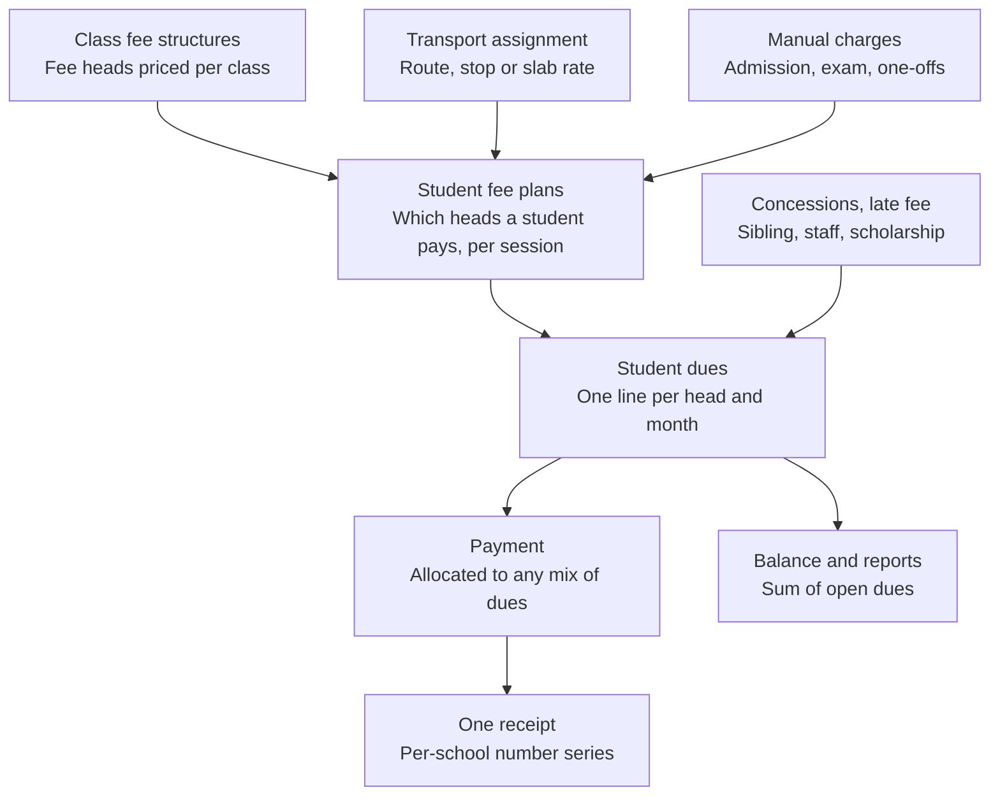

# Sunrise School: Multi-Tenancy & Unified Fee Redesign Plan

Nov 6, 2026 · Javed Ansari · Live version: https://claude.ai/artifact/G1QH43FrVzMPFVnxJLXBNa

## Overview

We will turn the Sunrise School backend into a multi-school (multi-tenant) service and replace the separate fee and transport billing code with one unified fee module. All work happens in the existing repository on a `multi-tenant` branch. The app is not in production, so old fee and transport data does not need to be migrated.

**Goals**

- Every school's data is isolated, so a user of one school can never read or change another school's records.
- All money a student owes (tuition, transport, admission, exam, one-off charges) is billed, paid, receipted and reported in one place.
- Transport keeps only operational data (vehicles, routes, stops, who rides what) and hands its charges to the fee module.

**Guiding decisions**

- Stay in this repository. The other modules (students, teachers, attendance, leave, inventory, gallery, auth) are reused and made tenant-aware.
- Build the tenant foundation first, then build the new fee module tenant-aware from its first line.
- No code changes until the open decisions in this doc are settled.

**How to use this doc:** check Progress for where work stands, then work through the Implementation phases checklist in order. Tick items as they land and update the Progress table at the end of each work session.

## Progress

Phase 1 is done (Nov 6, 2026). Every school's data is isolated in the `school` schema of the shared `warsi_db`, platform admins manage schools through `/api/v1/platform`, and 43 isolation and platform tests pass.

Phase 2 is done (Nov 11, 2026, merged in PR #3). The unified fee module lives in `app/modules/fees/` and is served at `/api/v1/billing`. Migration `V002` adds its 11 tables and is applied to the local `warsi_db`. 46 fee tests pass, 89 in total. The old `/fees` and `/transport` routes still work until Phase 4, and the new fee screens come in Phase 6. Deploying to DigitalOcean, including running `V002`, is deferred to go-live.

Phase 3 is done (Nov 11, 2026, merged in PR #4). The transport operations module lives in `app/modules/transport/` and is served at `/api/v1/transit`. Migration `V003` renames the old `transport_types` to `legacy_transport_types`, adds 7 tables and carries Sunrise's old price list over as rates. `V003` is applied to the local `warsi_db`. 45 transport tests pass; 133 of 134 pass in total. The one failure, `test_build_plans_and_generate_dues` in `tests/fees/test_ledger.py`, comes from local data, not from Phase 3: the test assumes session 2026-27 has only its own students, and the local database has 3 real students there. The new transport screens come in Phase 6. Deploying to DigitalOcean, including running `V003`, is deferred to go-live.

Phase 4 is done (Nov 11, 2026, merged in PR #5). The dashboard, student pages, reports, sibling waiver recalculation and the configuration endpoint now read the unified fee ledger and the transport operations module, through two small read-only services (`app/modules/fees/service/summary.py` and `app/modules/transport/service/summary.py`). The old `/fees` and `/transport` routes, their CRUD, schemas, models and receipt generators are deleted. Migration `V004` drops the 13 old tables and 3 old functions. A fresh deployment and a deployment migrated from the Phase 3 baseline were compared and are identical. `V004` is applied to the local `warsi_db`. All 146 tests pass on a clean migrated schema; on the local `warsi_db` 145 pass, and the one failure is the known local-data failure `test_build_plans_and_generate_dues`. The old fee and transport screens in the frontend stop working until Phase 6 replaces them. Next step: Phase 5, scope the remaining modules. Deploying to DigitalOcean, including running `V004`, is deferred to go-live.

Phase 5 is done (Nov 11, 2026, merged in PR #6). Raw SQL is now checked, not trusted: on a school session every `text()` statement must filter by `:school_id`, which `app/core/tenant.py` fills in from the session. A statement without it, or with another school's id, raises instead of running; queries on global lists only use `global_sql()`. All 62 raw SQL statements in 12 files are scoped. Fixed on the way: `/configuration` returned every school's classes, session years, departments and other lists; the dashboard counted another school's students, leave and expenses when given that school's session year (now 404); attendance defaulted to Sunrise's session year id 4 (now the school's current session). Generated emails use the school setting `user.email_domain` (Sunrise keeps `sunrise.com` through migration `V005`). Gallery, inventory and profile photo uploads go to `<school code>/<kind>` Cloudinary folders. The unused WhatsApp text notification with Sunrise's name hardcoded is removed. 169 of 170 tests pass on the local `warsi_db`; the one failure is the known local-data failure `test_build_plans_and_generate_dues`. `V005` is applied to the local `warsi_db`. Next step: Phase 6, frontend. Deploying to DigitalOcean, including running `V005`, is deferred to go-live.

Phase 6 is done (Nov 12, 2026, branch `frontend-phase6`). The frontend finds its school from the subdomain (`REACT_APP_BASE_DOMAIN`, or `<code>.localhost` locally, or a fixed `REACT_APP_SCHOOL_CODE`), sends it as `X-School-Code`, and brands itself from the new `GET /public/school`. The admin, teacher and student portals and the public site share one shell (`components/Layout/PortalLayout.tsx`) with a new left panel and theme (`src/theme.ts`). New screens: Fees (`/admin/fees`: collect, fee structures, fee heads, concessions, billing run, reports), Transport (`/admin/transport`: riders, routes and stops, vehicles, rates), the student's My fees, and platform admin (`/platform/login`, `/platform`). Backend additions: `GET /public/school`, `GET /public/admissions` (the Admissions page: the session families apply for, its key dates counted from the session start, and fees per class), `GET /billing/my/statement` and a student's own receipt. `tests/transport/test_screen_requests.py` sends the request bodies the screens send. The old fee and transport screens and `transportService.ts` are deleted. A Settings screen (`/admin/settings`, API `/api/v1/school-settings`) lets a school admin change the school's own profile (name, short name, contact details, logo), its settings (modules, fee, transport, receipt and account settings, each with a default) and its own lists (classes, session years, departments, positions, leave types, expense categories, gallery categories, and the shop lists while the shop is on). List rows are never deleted, only marked not in use, and every change clears that school's `/configuration` cache. The School Shop is now a per-school module, setting `module.shop.enabled`, off by default for every school: its menu and pages are hidden, `/inventory` answers 403 and the dashboard skips stock alerts until an admin turns it on in Settings. `tests/tenant/test_school_admin_settings.py` covers both (7 tests). Next step: Phase 7.

Phase 7 is done (Nov 12, 2026, branch `phase7-hardening`). PostgreSQL row-level security now backs the app's own checks: every one of the 46 tables with `school_id` has the forced policy `tenant_isolation` (migration `V006`, function `enable_tenant_row_level_security()`), and `app/core/tenant.py` sets `app.school_id` and `app.bypass_rls` per transaction from the session, so a query that slips past the ORM scoping and the raw SQL guard still only reaches its own school. A connection with neither setting sees no school rows. The deploy and migration scripts, `/database/status` and `create_platform_admin.py` set the bypass; the public `/health` no longer counts users, and the unauthenticated `POST /setup-database` is deleted. A new GitHub Actions workflow (`.github/workflows/backend-tests.yml`) deploys a fresh schema as an ordinary, non-superuser role and runs the isolation suite, then the fee and transport tests. The isolation suite (`tests/isolation`) sweeps every API route as a second school's admin against Sunrise's ids; it found no leak, but found six routes that failed for every school (fixed, see Phase 7). A second school is onboarded end to end through the API in `tests/isolation/test_onboarding.py`. `V006` is applied to the local `warsi_db`. On a clean schema all 201 tests pass (1 skipped: it needs Sunrise students). On the local `warsi_db`, 9 fee and transport tests fail because of data entered there on Nov 12 (a published 2026-27 fee structure, receipt `SUN/2026-27/000001` and a transport assignment); they assume an empty session. Deploying to DigitalOcean, including running `V006`, is deferred to go-live.

Status values: Not started, In progress, Done, Blocked.

| Phase | Status | Notes |
| --- | --- | --- |
| 0. Preparation | Done | Branch `multi-tenant` created. Tenant test suite runs against local Postgres in a rolled-back transaction |
| 1. Tenant foundation | Done | School isolation, school-aware login, clean 3.0 baseline in `warsi_db`, migration runner, platform admin and school management. DigitalOcean deployment deferred to go-live |
| 2. Unified fee module core | Done | Merged in PR #3. `/api/v1/billing`, migration `V002`. Payment gateway deferred (decision 11). Fee screens in Phase 6 |
| 3. Transport operations module | Done | Merged in PR #4. `/api/v1/transit`, migration `V003`. Transport screens in Phase 6 |
| 4. Switch dependents and remove old code | Done | Merged in PR #5. Migration `V004`, applied to the local `warsi_db` |
| 5. Scope the remaining modules | Done | Merged in PR #6. Migration `V005`, applied to the local `warsi_db`. Raw SQL guard in `app/core/tenant.py` |
| 6. Frontend | Done | Branch `frontend-phase6`. Adds `/public/school`, `/public/admissions`, `/billing/my/statement`, the Settings screen (`/school-settings`) and the per-school School Shop switch (off by default) |
| 7. Hardening | Done | Migration `V006` (row-level security), applied to the local `warsi_db`. CI workflow `backend-tests.yml`, isolation suite `tests/isolation` |

## Current state

Fees and transport are two parallel billing systems with the same shape: a charge, month-wise tracking, payments, allocations and reversals, each built twice. The service is single-school: no table has a school or tenant column.

| Concept | Fee module (today) | Transport module (today) |
| --- | --- | --- |
| Price list | `fee_structures`: one row per class and session, fixed columns (tuition, admission, development, activity, transport, library, lab, exam, other) | `transport_types`, `transport_type_pricing` (per session), `transport_distance_slabs` |
| What a student owes | `fee_records` (annual, with sibling waiver fields) | `student_transport_enrollment` (monthly fee, distance, pickup and drop text) |
| Month-wise dues | `monthly_fee_tracking` | `transport_monthly_tracking` |
| Payments | `fee_payments` (receipt number `FEE-000123`, Cloudinary receipt, reversals) | `transport_payments` (same fields, separate numbering) |
| Payment to month split | `monthly_payment_allocations` | `transport_payment_allocations` |
| Audit | `fee_payment_audit_log` | none |

**Code size and coupling**

- `endpoints/fees.py` is about 4,000 lines with 38 routes. `endpoints/transport.py` adds 887 lines and 13 routes. Business logic lives mostly in the endpoint files, not in CRUD or services.
- A `pay-combined` endpoint already exists to take tuition and transport in one transaction with one receipt. That workaround is the clearest signal that one fee module is wanted.
- Five modules outside these two read fee or transport data: dashboard, student siblings, reports, student CRUD and metadata.

**Pain points to fix in the redesign**

- Duplicate logic for dues, payments, allocations and reversals, so every fix is made twice.
- Fixed fee columns on `fee_structures`: adding a new fee head (for example, a computer fee) needs a schema change.
- `fee_structures.transport_fee` overlaps with the transport module's own pricing.
- Two receipt series and two payment histories per student, so the parent and the office see split balances.
- Hardcoded session years (`SessionYearEnum` stops at 2026-27) and a Sunrise-specific WhatsApp template and config.
- Globally unique `admission_number`, `employee_id` and `email`, which will clash once two schools share the database.

## Multi-tenancy design

Recommended model: one shared PostgreSQL database, with a `school_id` column on every school-owned table, enforced in a tenant-scoped base CRUD layer and later backed by row-level security. It is the simplest model to run and keeps a single migration path. The app's tables live in one schema (`DB_SCHEMA`, default `school`) of the shared `warsi_db` database, locally and on DigitalOcean, next to the `mart` schema.

**New tables**

- `schools`: id, code (short slug used in the subdomain), name, address, contact details, logo URL, timezone, currency, academic year start month, status (active or suspended), created_at.
- `school_settings`: per-school key and value settings such as the receipt prefix, WhatsApp sender and template IDs, late fee rules, and Cloudinary folder.

**How each request finds its school**

1. The frontend is served per school, at `<code>.<BASE_DOMAIN>`. The API reads the school from the `X-School-Code` header, else the subdomain of the `Origin` header (sent by browsers on every API call), else the `Host` header. Local development falls back to `DEFAULT_SCHOOL_CODE`.
2. Login checks the user against that school and puts `school_id` in the JWT (`sid` claim). Tokens without it are rejected, so users log in again once.
3. `get_current_user` reads `school_id` from the token, rejects the token on another school's subdomain, and binds the request's DB session to that school. Routes used before login (login, register, public pages, gallery) use `get_school_db` instead.
4. SQLAlchemy session events (`app/core/tenant.py`) add `school_id = <current>` to every ORM select, update and delete on a tenant model, including joins and relationship loads, and stamp `school_id` on every insert. A query or write on a tenant model without a school fails instead of leaking. This replaces the planned base CRUD filter, because 268 queries bypass `CRUDBase`. Raw SQL (`text()`) is not covered and is scoped by hand in Phase 5.
5. Phase 7 safety net: PostgreSQL row-level security policies on the same column, using a session variable set per request.

**Which tables get `school_id`**

| Group | Tables | Treatment |
| --- | --- | --- |
| School-owned data | students, teachers, users, attendance, leave, expenses, vendors, inventory, gallery, alerts, student siblings, student session history, all new fee and transport tables | Add `school_id NOT NULL`, index it, include it in unique keys |
| School-configurable lists | classes, session years, departments, positions, expense categories, gallery categories, inventory categories and types, leave types | Add `school_id`, name unique per school, auto-increment ids. Seed defaults for each new school |
| Fixed system lists | user types, genders, payment methods, payment statuses, attendance statuses, attendance periods, leave statuses, expense statuses, reversal reasons, qualifications, employment statuses, progression actions, alert types and statuses | Stay global, no `school_id` |

**Unique keys that change to per-school**

- `students.admission_number` becomes unique on (`school_id`, `admission_number`).
- `teachers.employee_id` becomes unique on (`school_id`, `employee_id`).
- Receipt numbers become unique per school.
- `users.email`: see Open decisions.

**Roles**

- A new platform admin role (user type `PLATFORM_ADMIN`) manages schools and is the only role allowed to act across schools. The existing `SUPER_ADMIN` type stays a school-level role, so the name is not reused.
- Existing roles (admin, teacher, student, parent) stay, scoped to their school.

**Per-school configuration to move out of code**

- School name and branding used in receipts, WhatsApp messages and the frontend.
- WhatsApp template IDs in `core/config.py`.
- Cloudinary folders for receipts and gallery images.
- Session years, generated per school instead of the hardcoded `SessionYearEnum`.

## Unified fee design

Proposal: one fee ledger in which every charge, whether tuition, transport, admission, exam or a one-off, is a row of the same kind tagged with a fee head. Payments, allocations, receipts, reversals and reports are written once and work for every fee head.

Tuition, transport and one-off charges all become plan lines, then dues. Payments settle dues, never a module, so a parent sees one balance and gets one receipt.

**Core ideas**

- **Fee heads instead of fixed columns.** Each school defines its own heads (Tuition, Transport, Admission, Exam, Computer, Late fee and so on). A new head is a row, not a migration.
- **Price lists by rule.** Class-based heads are priced per class and session. Transport is priced per route, stop or distance slab and session. Both feed the same ledger.
- **One due row per student, head and period.** This replaces `monthly_fee_tracking` and `transport_monthly_tracking`.
- **One payment can pay any mix of dues.** It produces one receipt from one per-school receipt series. This replaces `pay-combined`.
- **Concessions are explicit.** Sibling waivers, staff-child discounts and scholarships become concession rows with a reason and an approver, not fields copied onto each record.

**Proposed tables** (all carry `school_id`)

| Table | Purpose | Key columns |
| --- | --- | --- |
| `fee_heads` | The school's list of fee types | code, name, category (academic, transport, one-time, penalty), default frequency, is_active |
| `fee_structures` | Header for a price list | session_year_id, name, status (draft, published) |
| `fee_structure_items` | One price line in a list | fee_structure_id, fee_head_id, class_id (null means all classes), amount, frequency (monthly, quarterly, half-yearly, annual, one-time), billing months, due day |
| `student_fee_plans` | Which heads apply to a student in a session, and at what amount | student_id, session_year_id, fee_head_id, amount, start month, end month, source (class, transport, manual), source_ref_id |
| `concession_rules` and `student_concessions` | Discounts and waivers | type (sibling, staff, scholarship, custom), percent or fixed amount, fee heads covered, reason, approved_by |
| `student_dues` | One billable line per period | student_id, session_year_id, fee_head_id, period (year and month), gross amount, concession amount, late fee, net amount, paid amount, due date, status |
| `payments` | Money received | student_id, receipt_number, amount, method, date, transaction ID, receipt URL, created_by, reversal fields |
| `payment_allocations` | Which dues a payment settled | payment_id, student_due_id, amount, is_reversal |
| `receipt_sequences` | Per-school, per-session numbering | school_id, session_year_id, prefix, next number |
| `fee_audit_log` | Who changed what | entity, entity_id, action, old and new values, performed_by |

**Rules the module enforces**

- Dues are generated, never typed: from `student_fee_plans` for the session, by a "generate dues" action per school or class, and again when a student joins, changes class or starts or stops transport.
- A paid or part-paid due is never edited. A change creates an adjustment line or a reversal, so the ledger stays auditable.
- Allocation order for a payment is oldest due date first, unless the cashier picks specific dues.
- Student balance is always the sum of open `student_dues`, which gives one balance for parents, the office and the dashboard.

## Transport management after the split

Transport becomes an operations module. It decides who rides, on what, from where and at what rate. It never stores dues or payments. When a student is assigned or removed, it creates or ends a Transport line in `student_fee_plans`, and the fee module does the billing.

**Proposed tables** (all carry `school_id`)

| Table | Purpose | Key columns |
| --- | --- | --- |
| `transport_types` | Kinds of vehicle the school uses | name (E-Rickshaw, Van, Bus), capacity, is_active |
| `vehicles` | Each physical vehicle | transport_type_id, registration number, capacity, driver name and phone, is_active |
| `routes` | A named route | name, vehicle_id, is_active |
| `route_stops` | Ordered stops on a route | route_id, stop name, sequence, distance_km, pickup time, drop time |
| `transport_rates` | Price per session | session_year_id, pricing basis (flat per type, distance slab or per stop), transport_type_id, distance from and to km, route_stop_id, monthly amount |
| `student_transport_assignments` | Who rides what | student_id, session_year_id, route_id, stop_id, transport_type_id, start date, end date, monthly amount resolved from `transport_rates`, remarks |

**What happens on each event**

| Event | Transport module | Fee module |
| --- | --- | --- |
| Student assigned | Creates the assignment and resolves the monthly rate | Adds a Transport plan line from the start month, then generates its dues |
| Rate or stop changed | Ends the old assignment, starts a new one | Ends the old plan line, adds a new one. Paid months stay as they are |
| Student discontinued | Sets the end date | Ends the plan line and cancels future unpaid Transport dues |
| Service paused for some months | Records the paused months | Skips or waives those dues |

This replaces `student_transport_enrollment`, `transport_monthly_tracking`, `transport_payments`, `transport_payment_allocations`, `transport_type_pricing` and `transport_distance_slabs`. Vehicles, routes and stops are new. They are optional for a school that only needs flat or distance pricing.

## Open decisions

All 12 decisions were settled on Nov 6, 2026. Eleven follow the recommendation. Decision 2 was changed to subdomains only. On Nov 11, 2026 decision 8 was changed and decision 13 was added while building Phase 2.

| # | Decision | Options | Agreed approach | Status |
| --- | --- | --- | --- | --- |
| 1 | Existing data | Start with an empty database, or keep current data as school 1 | Keep the current data as school 1 (Sunrise) for the non-fee modules. Drop the old fee and transport tables | Agreed |
| 2 | How a school is identified at login | Subdomain, school code on the login page, or both | A subdomain per school, for example `sunrise.<domain>`. No school code field. Local development and tests use a configured default school | Changed |
| 3 | User email uniqueness | Unique per school, or one global login with access to several schools | Unique per school, on (`school_id`, `email`). Revisit only if one person must work in two schools | Agreed |
| 4 | Classes and session years | Global lists, or per school | Per school, seeded with defaults when a school is created | Agreed |
| 5 | Billing frequency | Monthly only, or per fee head (monthly, quarterly, half-yearly, annual, one-time) | Per fee structure item, default monthly | Agreed |
| 6 | Transport start or stop mid-month | Charge the full month, pro-rata by days, or a cut-off day | Full month, with a per-school cut-off day setting | Agreed |
| 7 | Late fee | None, fixed amount, or percentage. Automatic or manual | Per-school setting. Added automatically as a separate Late fee due after the grace days | Agreed |
| 8 | Sibling concession | Which fee heads it covers and which child gets it | One sibling rule per school, made of tiers: family size, the child's position (counted from the eldest or the youngest) and a percent. Siblings are ordered eldest first by date of birth, ties by admission number, counting only siblings enrolled in the same session. Nothing about birth order is stored; it is worked out each time dues are generated. Sunrise keeps its current rule (3 siblings: youngest 100%; 4: third child 50%, youngest 100%; 5 or more: the two youngest 100%), tuition only | Changed |
| 9 | Receipt number format | Global sequence, or per school and session | Per school and session, for example `SUN/2026-27/000123` | Agreed |
| 10 | Advance and excess payments | Reject, or hold as student credit | Hold as credit and apply it to the next dues automatically | Agreed |
| 11 | Online payment gateway | In scope now, or later | Later. Keep gateway fields (order ID, status) on `payments` now | Agreed |
| 12 | Row-level security | Now, or after the CRUD layer is scoped | After, as Phase 7 | Agreed |
| 13 | How siblings are linked | Detect them automatically (same father name and phone), or link them by hand | By hand. A "suggest siblings" button lists students with the same father name and phone, and links nothing until an admin confirms. Only admins add, edit or remove sibling links. Linking a student to a sibling joins their two families | Agreed |

## Implementation phases

There are eight phases, run in order. Each phase ends with the app running and its tests passing, so work can pause between phases.

### Phase 0: Preparation

- [x] Clean the working tree (uncommitted changes reverted on Nov 6, 2026)
- [x] Create the `multi-tenant` branch
- [x] Settle all Open decisions
- [x] Set up a test base: `sunrise-backend-fastapi/tests/tenant` runs against local Postgres inside a rolled-back transaction. The old `tests/backend` suite imports a missing module and does not run

### Phase 1: Tenant foundation

- [x] `schools` and `school_settings` tables, Sunrise seeded as school 1
- [x] `school_id NOT NULL` (no default) on 27 tables, with foreign key and index
- [x] Migration: per-school unique keys (list names, admission number, employee ID, student, teacher and user email)
- [x] Migration: auto-increment ids on the 9 list tables that had none
- [x] `TenantMixin` on the 27 models, plus `School` and `SchoolSetting` models
- [x] `school_id` in the JWT at login, `get_current_school` and `get_school_db` dependencies, token refused on another school's subdomain
- [x] Automatic session scoping and write stamping in `app/core/tenant.py` (replaces the base CRUD filter)
- [x] Configuration metadata cache keyed per school, HTTP caching set to private
- [x] CORS accepts every `*.BASE_DOMAIN` school subdomain in production
- [x] Clean database baseline 3.0: legacy migrations V001 to V036 folded into the table scripts and archived. Scripts are schema-agnostic and never change the database-wide `search_path`. Verified identical to the migrated legacy schema
- [x] App and scripts use a configurable schema (`DB_SCHEMA=school`) in the shared `warsi_db`. 67 hardcoded `sunrise.` table prefixes removed from raw SQL
- [x] `redeploy_database.py` drops and recreates only the `DB_SCHEMA` schema; `mart` and `public` are untouched
- [x] SSL support for DigitalOcean (`?sslmode=require` in `DATABASE_URL`)
- [x] Removed unused database objects: 5 views, `calculate_age`, `get_academic_year`
- [x] `migrate_database.py`: applies each `Database/Versioning/` migration once, recorded in `schema_migrations` with a checksum; stops on edited or failing migrations
- [x] Deployed to local `warsi_db` (schema `school`) and verified login
- Deferred to go-live: deploy to DigitalOcean `warsi_db` (schema `school`), then set `DATABASE_URL`, `DB_SCHEMA`, `BASE_DOMAIN` and `DEFAULT_SCHOOL_CODE` on the backend host
- [x] Delete the unauthenticated `POST /api/v1/database/deploy`. `redeploy_database.py` now deploys local databases directly from the complete `deploy_database.sql` list
- [x] Platform admin role (`PLATFORM_ADMIN`, user type 7, no school), migration `V001_add_platform_admin.sql`
- [x] Platform API `/api/v1/platform`: login, list, create, view, edit, suspend and activate schools, manage platform admins. Creating a school creates its admin and copies the template school's lists
- [x] `/database/status` and `/database/deploy-function` require a platform admin
- [x] `scripts/create_platform_admin.py` creates the first platform admin; `scripts/create_test_school.py` kept for quick local tests
- [x] 14 platform tests (token separation, school creation and list copying, validation, edit, suspend and activate)

### Phase 2: Unified fee module core

- [x] New package `app/modules/fees/` with models, schemas, repository, service and router layers, served at `/api/v1/billing`
- [x] Migration `V002_unified_fee_module.sql` (and `Tables/T900`-`T950`) for `fee_heads`, `fee_structures`, `fee_structure_items`, `concession_rules`, `student_fee_plans`, `student_concessions`, `student_dues`, `receipt_sequences`, `payments`, `payment_allocations`, `fee_audit_log`. The old `fee_structures` table is renamed `legacy_fee_structures`. Default fee heads, the sibling rule and fee settings are seeded for every school; new schools copy them from the template school
- [x] Fee head and fee structure management, with draft, publish (archives the previous published list), archive and copy
- [x] Plan builder: class-based plan lines for every student in a session. Safe to rerun; a class or price change ends the old line and starts a new one from `effective_from`. Manual one-off lines per student
- [x] Dues generation per school, class or student, through a given month (default: this month). Safe to rerun. Unpaid dues are re-priced on each run; paid dues never change
- [x] Concession rules, including the sibling rule (decisions 8 and 13), and staff, scholarship and custom concessions per student. Concessions on one due add up, capped at the due
- [x] Sibling links by hand (decision 13): automatic linking removed from student create and update, "suggest siblings" route, link, change type and remove routes for admins only. Fixed two old bugs: linking A to B dropped B's links to its other siblings, and every rebuild reset the relationship type
- [x] Late fees (decision 7): `POST /billing/late-fees/apply`, also run during dues generation. A scheduled job comes later
- [x] Payment collection across any mix of dues (oldest first, chosen dues or exact amounts), one receipt number per school and session under a row lock, credit held and applied to new dues automatically (decision 10)
- [x] Receipt PDF from the school's own details and settings (`receipt.logo`, `cloudinary.receipt_folder`, `whatsapp.media_receipt_template_sid`, `whatsapp.receipts_enabled`), upload to Cloudinary and WhatsApp send. Sunrise's name, address, email, website and logo moved from code into its school record and settings
- [x] Full and partial reversals as REVERSAL entries with negative allocations, credit taken back first, with audit log entries
- [x] Reports: collection by day, method and fee head, pending dues by class, student ledger with running balance, consistency check

### Phase 3: Transport operations module

- [x] New package `app/modules/transport/` with models, schemas, repository, billing (the fee handoff), service and router layers, served at `/api/v1/transit` (`/transport` stays with the old code until Phase 4)
- [x] Migration `V003_transport_operations.sql` (and `Tables/T960`-`T985`) for `transport_types`, `vehicles`, `routes`, `route_stops`, `transport_rates`, `student_transport_assignments` and `transport_assignment_pauses`. The old global `transport_types` is renamed `legacy_transport_types` (old model `LegacyTransportType`, alias `TransportType`). Every school gets E-Rickshaw, Van and Bus; Sunrise's old flat prices and van distance slabs become rates for 2025-26 and 2026-27; new setting `fee.transport.due_day` (default 10). New schools copy the template school's types
- [x] Rates per session: PER_STOP, then DISTANCE_SLAB (covers (from, to]), then FLAT, type-specific before any-type. The amount is copied onto the assignment, so editing a rate never changes past billing. Overlapping slabs and duplicate flat or stop rates are refused. Quote and copy-to-next-session routes
- [x] Assign, change, discontinue and cancel flows that create and end Transport plan lines in the fee module (`plans.sync_source_lines`), then generate the student's dues. Cut-off day (decision 6): riding that starts on or before the cut-off day bills that month; a last riding day on or after it bills that month. A change ends the old assignment the day before and starts a new one; paid months stay as they are. Cancel is refused once money was paid. Manual TRANSPORT plan lines and ending a TRANSPORT line by hand in `/billing` are refused
- [x] Paused months (`transport_assignment_pauses`): cut out of the plan lines, refused for paid months, carried over to the new assignment on a change; removing a pause bills the months again
- [x] Route and vehicle rosters (who rides which route and stop on a day, paused riders marked, seats and over-capacity). A full vehicle is refused unless `allow_over_capacity` is sent
- [x] `V003` applied to the local `warsi_db`
- Later list: carry assignments over to the next session, a bulk "reprice from month X" for a rate change

### Phase 4: Switch dependents and remove old code

- [x] Point dashboard, student siblings, reports, student CRUD and metadata at the new modules, through read-only summary services in each module. Dashboard and report responses keep their shape; the daily collection report also splits each payment into its fee and transport parts. Sibling waiver recalculation re-prices unpaid dues. Transport types in `/configuration` come from the school's own list
- [x] Delete old fee and transport endpoints, CRUD, schemas, models, receipt generators, the `FeeValidator` and the `/database/deploy-function` endpoint
- [x] Migration `V004_drop_legacy_fee_transport.sql`: drops the 13 old tables and the functions `enable_monthly_tracking_complete`, `enable_transport_monthly_tracking` and `calculate_fee_balance`. It refuses to run while an old payment table holds payments. Their table, function and data scripts are removed from `deploy_database.sql`; `Init/05_transport_defaults.sql` now seeds Sunrise's transport rates directly
- [x] Fixed on the way: `/students/{id}/profile` read columns that no longer exist and failed on every call
- [x] `V004` applied to the local `warsi_db`
- Not carried over: the old tuition price list (`legacy_fee_structures`). Sunrise sets up its 2026-27 fee structure in `/billing` (decision 1)

### Phase 5: Scope the remaining modules

- [x] Scope the raw SQL (`text()`) queries by `school_id`: 62 statements in 12 files. ORM queries were already scoped
- [x] Raw SQL guard in `app/core/tenant.py`: on a school session a `text()` statement must use `:school_id` (filled in from the session; another school's id is refused), or be built with `global_sql()` when it reads only global lists or pure functions. Anything else raises `TenantContextError`. Sessions under `tenant_bypass` (platform work) are not checked
- [x] Joins without a foreign key (leave `applicant_id`, the class teacher join) also require the joined row's school to match
- [x] Database views: none left (the 5 views were removed in Phase 1)
- [x] Per-school email domain: setting `user.email_domain`, default `<code>.<BASE_DOMAIN>` (or `<code>.local`). Migration `V005` and `Init/06_school_settings.sql` keep `sunrise.com` for Sunrise. The phone-based fallback login email no longer uses `sunriseschool.edu`
- [x] No `DEFAULT 1` on `school_id` (removed in the 3.0 baseline)
- [x] Students, teachers and users: profile and dashboard queries, teacher lists and statistics scoped
- [x] Attendance and leave: all list, summary, statistics and absence queries scoped. Attendance routes default to the school's current session year instead of Sunrise's id 4 (`get_session_year_id` in `app/api/deps.py`)
- [x] Expenses, vendors and inventory: expense queries scoped; vendors and inventory use only ORM queries
- [x] Gallery, alerts, progression and session history: ORM only; dashboard history queries scoped
- [x] `/configuration` lists: the per-school lists in the metadata query (classes, session years, departments, positions, leave types, expense categories, gallery and inventory lists) are filtered by school. Before this, every school saw every school's lists
- [x] Dashboard: an unknown or another school's session year returns 404 instead of falling back to Sunrise's session id 4
- [x] Cloudinary folders: gallery, inventory and profile photos upload to `<school code>/<kind>`, overridable with `cloudinary.<kind>_folder`. Old images keep their URLs; inventory finds the old image's public id from any folder
- [x] WhatsApp and branding: receipts already use per-school settings (Phase 2). The unused text notification with Sunrise's name and `TWILIO_WHATSAPP_TEMPLATE_SID` is removed
- [x] Tests: `tests/tenant/test_raw_sql_scoping.py` (guard, every scoped module, dashboards, configuration) and `tests/tenant/test_school_settings.py`
- [x] `V005` applied to the local `warsi_db`
- Later list: the default password `Sunrise@001` is shared by every school (`core/password_config.py`); the sibling waiver shown on student sibling pages comes from SQL functions with Sunrise's rule, not the school's concession rule; lists referenced by id in request bodies (leave type, expense category and so on) are not checked to belong to the school

### Phase 6: Frontend

- [x] School-aware login (by subdomain) and per-school branding (`config/school.ts`, `contexts/SchoolContext.tsx`)
- [x] New fee screens: heads, structures, concessions, generate dues, collect payment, student ledger, reports; student's My fees
- [x] New transport screens: routes, stops, vehicles, rates, assignments
- [x] Super admin screens for managing schools (`/platform`)
- [x] One shell and theme for the portals and the public site; public Admissions page shows the published fee structure
- [x] Settings screen for school admins: profile, settings and the school's own lists (`pages/admin/SchoolSettings.tsx`, `/api/v1/school-settings`)
- [x] School Shop as a per-school module (`module.shop.enabled`), off for every school until turned on in Settings
- [x] Phase 6 signed off (Nov 12, 2026)

### Phase 7: Hardening

- [x] PostgreSQL row-level security on `school_id`: forced policy `tenant_isolation` on all 46 tables with `school_id` (`Functions/F900_tenant_row_level_security.sql`, `Schema/90_enable_row_level_security.sql`, migration `V006`). A row is visible and writable only for the school in `app.school_id`, or with `app.bypass_rls = on`. `app/core/tenant.py` sets both, transaction-local, before every statement and flush, and again after a savepoint rollback
- [x] Scripts and raw connections: `redeploy_database.py`, `migrate_database.py`, `deploy_database.sql`, `scripts/create_platform_admin.py` and `/database/status` set the bypass. `/health` no longer counts users (public route). The unauthenticated `POST /setup-database` is deleted
- [x] `tests/tenant/test_row_level_security.py` (12 tests): the app role is not a superuser and has no `BYPASSRLS`, every `school_id` table has the forced policy, and SQL sent straight to the connection, past every app check, stays in its school
- [x] Cross-school isolation suite (`tests/isolation/test_route_sweep.py`): every API route, taken from the app, as the second school's admin against Sunrise's ids. List routes show none of Sunrise's marker texts; id routes answer 403 or 404; write routes change none of Sunrise's rows; school tokens are refused on platform routes. A new path parameter must be given a value in the test, so new routes are swept too
- [x] CI: `.github/workflows/backend-tests.yml` runs on pushes to `main` and on pull requests that touch the backend or `Database/`: PostgreSQL 16, an ordinary owner role like `warsi_user`, fresh deploy, no pending migrations, isolation suite, then fee and transport tests
- [x] Second test school onboarded end to end (`tests/isolation/test_onboarding.py`): platform admin creates Pinecrest, its admin logs in on its subdomain, branding and copied lists, email domain, fee structure, student admission, plans and dues, transport fleet, rate and rider, a payment in its own receipt series, the student's own statement, the shop switched on for Pinecrest only, and neither school sees the other
- [x] Fixed on the way (the sweep found them; each failed for every school): `GET /students/{id}` imported a missing module, `GET /students/class/{name}` used a column that no longer exists, `GET /teachers/department/{name}` passed the wrong argument, the yearly and monthly expense reports read a missing key, `DELETE /expenses/{id}` queried the response schema instead of the table, and `GET /session-progression/history/{id}` never filled the student's name (now 404 for an unknown student). `tests/isolation/test_fixed_routes.py`
- Later list: without `BASE_DOMAIN` (local, CI) a new school's default email domain is `<code>.local`, which email validation refuses, so the school must set `user.email_domain` in Settings before admitting students; the items on the Phase 5 later list

## Risks and testing

The biggest risk is a query that forgets the school filter and leaks another school's data. The design answers that in three layers: the base CRUD class, isolation tests, then row-level security.

| Risk | Mitigation |
| --- | --- |
| Raw SQL bypasses the tenant filter | ORM queries are scoped automatically by session events and fail closed without a school. Raw SQL must filter by `:school_id` or it raises (Phase 5). Row-level security in Phase 7 covers anything missed |
| `POST /api/v1/database/deploy` dropped and rebuilt the whole schema with no login | Resolved Nov 6, 2026: endpoint deleted. Local redeploys use `redeploy_database.py`, which only accepts local databases and runs in one transaction |
| Old and new fee tables share names (`fee_structures`, `transport_types`) | First Phase 2 migration renames the old tables to `legacy_*`, and old models point at those names until Phase 4 deletes them |
| Money rounding and balance drift | `DECIMAL(10,2)` everywhere. Balance is always derived from dues and allocations. A consistency check compares them |
| Dues generated twice for the same period | Unique key on (`school_id`, `student_id`, `fee_head_id`, `session_year_id`, period) |
| Two cashiers issue the same receipt number | Take the next number with `SELECT … FOR UPDATE` on `receipt_sequences` inside the payment transaction |
| Scope grows while redesigning | Anything not in this doc goes to a later list, not into the current phase |

**Tests to write**

- [x] Isolation: a user of school A gets 404 for every school B record, on every list and detail route (`tests/isolation`).
- [x] Fee ledger: dues generation, concessions, part payments, allocation order, credit balance, full and partial reversal.
- [x] Transport to fee handoff: assign, change rate, discontinue mid-session, paused months (`tests/transport`).
- [x] Dependents on the new modules: dashboard, reports, student pages, configuration, sibling re-pricing, old routes gone (`tests/transport/test_dependents.py`).
- [x] Receipts: numbering is per school and session with no gaps or duplicates under concurrent payments (`tests/fees/test_ledger.py`).
